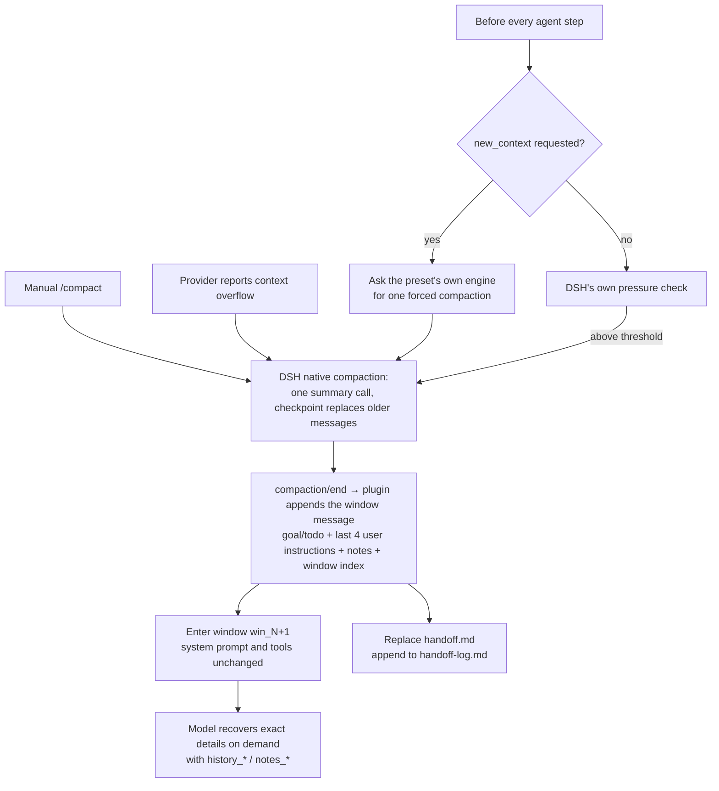

# dsh-multi-window-context-management

**English** · [简体中文](./README.zh-CN.md)

Windowed context handoffs, session-private notes and paged history recall for [DeepSeek Harness (DSH)](https://github.com/deepseek-ai/deepseek-harness). The multi-window idea is borrowed from Codex, but this is **not a 1:1 port of the Codex API, and it does not promise lossless recovery of every detail**.

## Compatibility

Version **0.6.1**, verified on **DSH 0.2.2-rc.1 / Node.js ≥ 22.15**. Peer ranges are `>=0.1.7-alpha.1 || >=0.2.0-0`, admitting the 0.2.0 prereleases with no upper bound on stable releases: since 0.1.7-rc.1, DSH skips at startup any plugin whose peer range excludes the running version, so an upper bound would silently disable the plugin after a DSH upgrade. Compatibility is judged by capability instead, through the [preflight check](#preflight-check).

- **Compaction stays native in every preset.** The plugin never replaces, subclasses or patches DSH's compaction engine, and touches no preset. DSH upgrades need no extra step, and presets you create yourself are covered automatically.
- After each committed DSH compaction, the plugin appends one **window message**: goal, todos, the last user instructions and recent notes. That message opens the next window. The summary itself is DSH's own checkpoint, unchanged and unclipped, with its real provider/model/usage.
- `new_context` finds the engine of the caller's own preset through `agentPresets.serviceFor(agent, 'compaction')` and asks it for one forced compaction. Native tool-call pairing, retention, maintenance lock, cancellation, shrink check, transaction, persistence and overflow retry all apply unchanged.
- The window number only advances once DSH actually commits the replacement. Failures, cancellations and "nothing to compact" never report a successful switch.
- Unloading or disabling the plugin leaves native compaction exactly as DSH ships it.

## How it works



A session cannot append while it is publishing an event, so the window message follows `compaction/end` on a microtask. That still runs before the compacting engine resumes, so an overflow retry already sends it. The threshold and the verbatim tail are DSH's own settings (`thresholdRatio`, `headroomTokens`, `retainRatio`), which this plugin does not change.

## Tools

| Tool | Purpose |
| --- | --- |
| `new_context` | Request a window switch at the next safe step boundary |
| `notes_read` | Read by `path`; search with `query`; omit both to list files. `prefix` filters listing/search |
| `notes_write` | Persist a note with required `mode: "replace"` or `"append"` |
| `history_search` | Browse messages, optionally search with `query`; use `scope: "windows"` for the paged window directory |
| `history_read` | Read an item by ID, including the summary, goal and checklist IDs printed in window messages |

The settings section, the plugin list entry, the `/ctx` command text, the system prompt section and the window handoff follow the DSH language: English and Chinese ship with the plugin, and any other preference falls back to English. `notes_read`, `notes_write`, `history_search` and `history_read` are only offered after the session's first window rotation (`lazyTools`, on by default): a session that never rotates pays for `new_context` alone. All tools are scoped to the calling session; no session selector is exposed. Reads and writes stay separate. Note listing/search uses newest-updated order; sorting aliases are no longer exposed. `notes_read` returns `files` for listing, `matches` for search, or a paginated body for a path. Path reads cannot be combined with search/list options. History discovery returns `items`, `matches` or `windows`, plus `has_more` / `next_cursor`.

Examples: `notes_write({path: "progress.md", text: "Tests passed", mode: "replace"})`, `notes_read({query: "Tests"})`, `history_search({scope: "windows", limit: 10})`, `history_read({item_id: "item_42"})`.

## Usage

`/ctx` toggles the plugin; `/compact` runs DSH's native compaction, which then opens a new window. The toggle applies to **every session of the running DSH instance**, not to a single chat tab.

When the model calls `new_context` it gets back **requested**, not a reset: the switch is scheduled for the next safe step boundary, after the current step's tool results are fully written to history. Explicit switch requests are honoured even when DSH's `auto` compaction is off. A preset with no compaction engine refuses `new_context` with a clear error, while the notes/history tools stay usable.

The web "Context management" settings page uses DSH `configForms` and shares its backend setting with `/ctx`. Read failures, read-only connections and failed saves are never shown as a successful toggle. Settings changes need no restart. Every registration goes through the Cordis lifecycle, so a hot swap (dispose + re-apply) removes all five tools, the `/ctx` command, the prompt section, both listeners and the `contextWindows` service (session state and settings, read by other plugins such as dsh-autocompact), then re-installs exactly one of each while notes are rebuilt from their durable store. DSH's `hmr` entry watches only its configured `root` directories, so add this plugin's `lib` there to reload on source edits; otherwise **reload the plugin or restart DSH, then refresh the page** after upgrading the plugin code.

## Storage and recovery

History is read straight from the caller's own immutable DSH session log:

- `item_<seq>` is a stable event address; nothing is indexed twice and old records are not dropped past 2,000 entries.
- Native tool results are linked to their names by call ID; `tool/code-dispatch` (PTC) is searchable too.
- `history_read` with `format: "json"` pages through complete raw events, including call arguments and metadata.
- Windows are delimited by the plugin's window messages, each tied to its compaction by a `<window_record>`. Old events kept in the retained tail still belong to the window that produced them. Sessions written by 0.3.x, whose handoff lived inside the summary, are still read.

Notes are isolated per session under `self/notes/<path>`; **there is no arbitrary cross-session read/write**. They live in the plugin's own directory, `$DSH_HOME/context-management/notes/<sessionId>.json` (`$DSH_HOME` resolved by `dsh-home-paths`), independent of the session-persistence backend's private layout, and are written with DSH's atomic write and cross-process file lock. A failed write never swaps unsaved state into the cache.

After every committed window switch (automatic, `/compact` or `new_context`) the plugin writes two notes itself: `handoff.md` is replaced with the latest summary copy (raw output, capped at 200,000 characters with a truncation marker), and `handoff-log.md` gains one line with the window, time, summary item and first line. Only the latest summary copy is kept; complete original events, including raw output, remain available through `history_read` with `format: "json"`. Neither note is injected into the window message, because the summary is already in the conversation. A cancelled or failed compaction writes nothing, and a failed note write is logged without blocking the switch. Writes are queued per session and tied to the committed window, so slow writes do not skip intermediate rotations or block other sessions.

Notes load on demand, not for every session at startup. On restore, window metadata is rebuilt and that session's notes are loaded; an unfinished transient switch request is not re-executed after a restart.

Include `context-management/notes/` when backing up or migrating; **deleting a session does not delete its notes file**. Forked sessions get independent notes; parent notes are not implicitly shared.

## Limits

| Operation | Default / hard limit |
| --- | --- |
| Window message (`handoffMaxChars`) | 6,000 characters by default, configurable 4,000–32,000; the native summary is separate and sized by DSH's own `maxTokens` |
| Injected notes | Up to the 4 most recent, ~800 characters each, within the message budget |
| Single note file | 1,000,000 UTF-8 bytes |
| Notes per session | 64 files / 4,000,000 UTF-8 bytes; over-limit writes are rejected, never silently evicted |
| History list / search | 20 items by default, 50 max; 400 characters per item by default, 1,000 max |
| History scan per page | Up to 2,000 events or ~2,000,000 content characters; a single large event is checked in full |
| History preview per page | Up to 12,000 characters in total, plus item metadata |
| History / note body reads | 8,000 characters by default, 20,000 max |
| Note search | Up to 10 files × 5 lines; 400 characters per line |

History queries return `has_more` and `next_cursor`; keep the same filters and order when continuing. Body reads continue with `next_offset_chars`. Note search is case-sensitive; history search also supports `case_sensitive: false`. Window directory pages use the same cursor convention (default 20, max 50 windows).

The last four user instructions are quoted in chronological order, up to 1,000 characters each, with their event addresses, later corrections taking precedence. The window message also keeps the active goal, open todos and a bounded set of recent notes; exact raw evidence is recovered through the history tools.

## Installation

This plugin is not published to npm; the `@local/` scope marks it as a local plugin. Using the web profile as an example:

1. Clone and install dependencies:

   ```bash
   git clone https://github.com/overact/dsh-multi-window-context-management.git
   cd dsh-multi-window-context-management && npm install
   ```

2. Run the [preflight check](#preflight-check) to confirm the installed DSH provides every capability the plugin needs and nothing in the profile collides with it:

   ```bash
   npm run preflight -- --profile web
   ```

3. In the profile directory (`$DSH_HOME/profiles/<profile>/`), add a local link to `dependencies` in `package.json`, then run `pnpm install` there:

   ```json
   "@local/dsh-multi-window-context-management": "link:<plugin-dir>"
   ```

4. Register the plugin in the profile's `cordis.patch.yml` (see Configuration below).

5. Restart DSH and refresh the page.

### Upgrading from 0.4.x

0.5.0 replaces the ten-tool interface with the five tools above. Old tool names are no longer registered; update external prompts or scripts that invoke them. Writes must select `mode`; listing/search aliases and `agent_name` inputs are removed. Existing notes, session logs and item IDs need no migration. Reload the plugin and refresh the client to use the new definitions; historical messages may still quote the old names.

### Upgrading from 0.3.x

0.3.x mounted its own engine by restating the shipped presets in a generated block of the profile patch. That engine is gone, so delete the block between `# >>> context-management preset overrides` and `# <<< context-management preset overrides`, and change any remaining `@local/dsh-multi-window-context-management/compaction` row back to `@deepseek-ai/dsh-compaction-basic`. Until you do, the preflight's *legacy preset overrides* check fails. The `handoffSummary` setting is gone too: a stored value is ignored, and every window now uses the native summary.

## Preflight check

`scripts/preflight.mjs` checks that the target DSH **actually provides** each capability the plugin uses, and that nothing in the profile collides with it. It **never compares version numbers**: the requirement list is extracted from the `lib/` sources (DSH imports, `ctx.<service>.<method>` calls, events, session-log event types, tool and command names), so new usages in the code are covered without touching the check.

| Check | Level | What it verifies |
| --- | --- | --- |
| DSH imports | fail | The target DSH packages really export the functions/classes the plugin imports |
| Preset compaction | fail | The native engine has `compactIfNeeded()` and the preset registry has `serviceFor()`, the two seams `new_context` uses |
| Host services | fail | The packages providing the services the plugin calls (`tools`, `sessions`, `commands`, `systemPrompt`, `settings`) have those methods |
| Host events, session-log types | fail | DSH still emits the events and session event types the plugin listens for |
| Notes storage | fail | The notes directory under `$DSH_HOME` is writable |
| Tool and command names | fail | Neither DSH itself nor another profile plugin defines a tool or command with the same name |
| Legacy preset overrides | fail | The profile patch no longer mounts the 0.3.x engine |
| Web client packages and services | warn | The client packages and `configForms`/`slots`/`locale` services behind the settings page exist; without them `/ctx` still works |

It exits with code 1 when any fail-level check fails. Running it after a DSH upgrade is optional: nothing in the profile depends on the DSH version.

## Configuration

```yaml
- insert:
    - id: context-management
      name: '@local/dsh-multi-window-context-management'
      config:
        enabled: true
        overrideCompaction: true
        injectTools: true
        lazyTools: true              # notes/history appear after the first rotation
        defaultStrategy: window      # or native: models not listed in modelPolicies get no window messages
        modelPolicies: []            # e.g. [{ provider: deepseek, model: deepseek-chat, strategy: native }]
        handoffMaxChars: 6000        # 4000–32000
```

| Key | Default | Meaning |
| --- | --- | --- |
| `enabled` | `true` | Enable context management for every session of this DSH instance; this is what `/ctx` toggles |
| `overrideCompaction` | `true` | Append the window message after each native compaction and open a new window |
| `injectTools` | `true` | Provide the notes/history/new_context tools; when off, compaction is purely native |
| `lazyTools` | `true` | Offer notes/history only after the session's first window rotation; `false` keeps all five tools from the start |
| `defaultStrategy` | `window` | Default strategy; `native` makes unlisted models compact natively without window messages |
| `modelPolicies` | `[]` | Per exact provider/model strategy overrides; the first match wins |
| `handoffMaxChars` | `6000` | Maximum characters of the window message, not counting the native summary |

`injectTools: false` removes the tools and leaves compaction purely native, so history is never trimmed without a way to recover it. `overrideCompaction: false` keeps the notes/history tools while compaction runs without window messages; `new_context` is then refused.

## Verification

```bash
npm install
npm run verify
```

Tests need the DSH dev dependency; alternatively point `DSH_PACKAGE_DIR` at an installed `@deepseek-ai/dsh` package directory. The summarizer is a fixed local fixture on DSH's real `BasicCompactionEngine`, so **the tests never call a paid model**. They run in a single-process Node test runner to avoid restarting the DSH test runtime.

Coverage includes the real Cordis lifecycle, DSH ToolRuntime, SettingsProvider, TokenMeter, BasicCompactionEngine, `/compact`, overflow recovery and JSONL disk recovery, plus web settings binding, session isolation, tool pairing, cancellation, failure paths and capacity limits. The web tests check the state/write contract; they are not a full visual browser test.

History reads are incremental: building state for 10,000 synthetic events takes ~2.5 ms the first time, and an unchanged re-read scans **0 events** (timings are indicative only; the regression tests pin incremental reads, scan limits and output limits).

0.5.0 passes 79 tests on DSH 0.2.1-rc.3, including the preflight: a stand-in DSH missing one seam must make it report exactly that capability.

## Code layout

| Module | Responsibility |
| --- | --- |
| `lib/index.js` | Host plugin: config schema, tool and command registration, compaction and pre-step listeners, settings changes |
| `lib/window-controller.js` / `window-engine.js` / `window-policy.js` | Forced rotation through the preset's engine, the window message, per-model strategy |
| `lib/handoff-note.js` | Writing `handoff.md` and `handoff-log.md` after each committed switch |
| `lib/session-state.js` | Incremental per-session state projection (windows, goal/todo, pending requests) |
| `lib/history-store.js` / `lib/tools/history.js` | Paged session-log recall and the history tools |
| `lib/notes-store.js` / `lib/note-repository.js` / `lib/tools/notes.js` | In-memory note model, locked atomic persistence, the notes tools |
| `lib/tools/new-context.js` | The `new_context` tool |
| `lib/text.js` | Message text extraction and clipping |
| `lib/client.js` | Web settings page (lazy-CJS client module) |
| `scripts/preflight.mjs` / `dsh-env.mjs` | Pre-install capability check, locating DSH and the profile |

## License

[MIT](./LICENSE)
