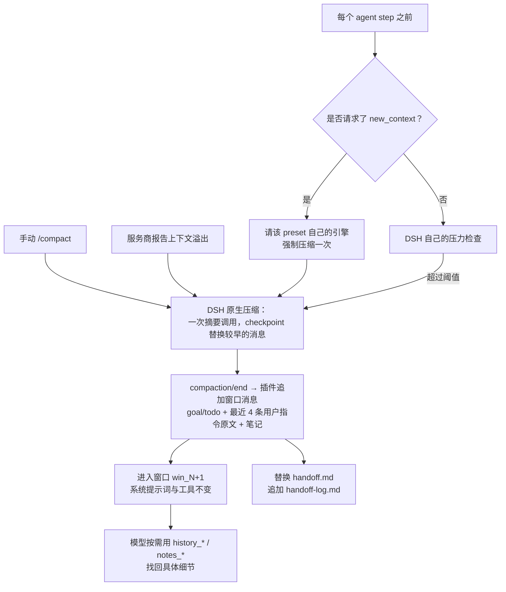

# dsh-multi-window-context-management

[English](./README.md) · **简体中文**

[DeepSeek Harness（DSH）](https://github.com/deepseek-ai/deepseek-harness) 的换窗交接、会话私有笔记和分页历史检索插件。借鉴 Codex 的多窗口思路，**不是 Codex API 的 1:1 移植，也不保证模型无损恢复全部语义**。

## 当前适配

版本 **0.6.0**，已针对 **DSH 0.2.2-rc.1 / Node.js ≥ 22.15** 验证。peer 范围为 `>=0.1.7-alpha.1 || >=0.2.0-0`（显式允许 0.2.0 预发布版本，稳定版本不设上限）：DSH 0.1.7-rc.1 起会在启动时跳过 peer 范围不含当前版本的插件，设上限会让插件在 DSH 升级后被静默跳过。兼容性改由[安装前检查](#安装前检查)按功能判断，而不是按版本号。

- **每个 preset 的压缩都保持原生。** 插件不替换、不继承、也不修补 DSH 的压缩引擎，不碰任何 preset。升级 DSH 不需要额外步骤，你自己新建的 preset 也自动生效。
- 每次 DSH 提交一次压缩后，插件追加一条**窗口消息**：目标、待办、最近几条用户指令和近期笔记，由它开启下一个窗口。摘要本身就是 DSH 自己的 checkpoint，不改动、不截断，并保留真实的 provider/model/usage。
- `new_context` 通过 `agentPresets.serviceFor(agent, 'compaction')` 找到调用者所在 preset 的引擎，请它强制压缩一次。原生的工具调用配对、近期保留、维护锁、取消、缩减检查、事务、落盘和 overflow 重试全部照常生效。
- 只有 DSH 真正提交替换，窗口编号才推进。失败、取消和无可压缩历史不会假报换窗成功。
- 卸载或停用插件后，压缩与 DSH 出厂行为完全一致。

## 工作原理



会话发布事件期间不能再追加事件，所以窗口消息在 `compaction/end` 之后的一个微任务里追加。这一步仍然发生在压缩引擎继续执行之前，所以溢出后的重试请求已经带上它。阈值和原文保留量是 DSH 自己的设置（`thresholdRatio`、`headroomTokens`、`retainRatio`），插件不改动它们。

## 工具

| 工具 | 作用 |
| --- | --- |
| `new_context` | 请求在下一个安全 step 边界换窗 |
| `notes_read` | 传 `path` 读文件；传 `query` 搜索；都不传则列目录；`prefix` 限定目录或搜索范围 |
| `notes_write` | 持久化笔记，必须指定 `mode: "replace"`（覆盖）或 `"append"`（追加） |
| `history_search` | 浏览消息，可用 `query` 搜索；`scope: "windows"` 分页列出窗口目录 |
| `history_read` | 按 ID 读原文，也支持窗口消息标明的摘要、目标和清单 ID |

`notes_read`、`notes_write`、`history_search`、`history_read` 只在会话首次换窗后才提供（`lazyTools` 默认开启）：从未换窗的会话只付 `new_context` 的 schema 开销。所有工具限定在调用者的会话内，不暴露会话选择参数。读写分开；笔记目录和搜索固定按最近更新时间排序，不再暴露排序别名。`notes_read` 列目录返回 `files`，搜索返回 `matches`，按路径读取返回分页正文。按路径读取不能混用搜索或目录选项。历史发现返回 `items`、`matches` 或 `windows`，附带 `has_more` / `next_cursor`。

示例：`notes_write({path: "progress.md", text: "测试通过", mode: "replace"})`、`notes_read({query: "测试"})`、`history_search({scope: "windows", limit: 10})`、`history_read({item_id: "item_42"})`。

## 使用

`/ctx` 切换开关；`/compact` 执行 DSH 原生压缩，完成后开启新窗口。开关作用于**当前 DSH 实例的所有会话**，不是某个聊天标签。

模型调用 `new_context` 时，返回的是 **requested**，不是 reset：换窗安排在下一个安全 step 边界，本步工具结果会先完整写入历史。若 DSH 的 `auto` 关闭，插件仍处理显式换窗请求。没有压缩引擎的 preset 会明确拒绝 `new_context`，notes/history 工具仍可用。

网页“上下文管理”页使用 DSH 的 `configForms`，与 `/ctx` 共用后端设置。读取失败、只读连接和保存失败不会伪装成切换成功。设置修改无需重启。所有注册都走 Cordis 生命周期：热插拔（卸载 + 重新挂载）会移除全部 5 个工具、`/ctx` 命令、系统提示词段、两个监听器和 `contextWindows` 服务（会话状态与设置，供 dsh-autocompact 等插件读取），再重新各装一份，笔记从持久存储重建。DSH 的 `hmr` 只监视它配置的 `root` 目录，把本插件的 `lib` 加进去即可改代码即重载；否则**升级插件代码后，运行中的 DSH 仍需要重载插件或重启，并刷新网页**。

## 保存与恢复

历史直接读取调用者自己的不可变 DSH 会话日志：

- `item_<seq>` 是稳定事件地址，不重复索引、不因条目数超过 2,000 而丢弃旧记录。
- 原生工具结果通过 call ID 关联名称；`tool/code-dispatch`（PTC）也可检索。
- `history_read` 的 `format: "json"` 可分页读取完整原始事件，包括调用参数和元数据。
- 窗口按插件的窗口消息划分，每条消息通过 `<window_record>` 对应到它的那次压缩。保留尾部的旧事件仍归属于其最初产生的窗口。0.3.x 写下的会话（交接放在摘要里）仍能正常读取。

笔记按会话隔离，默认路径为 `self/notes/<path>`，**不开放任意跨会话读写**。文件位于插件自有目录 `$DSH_HOME/context-management/notes/<sessionId>.json`（`$DSH_HOME` 由 `dsh-home-paths` 解析），不依赖会话持久化后端的私有布局；使用 DSH 原子写入与跨进程文件锁。失败不会把未保存状态替换进缓存。

每次换窗提交后（自动、`/compact` 或 `new_context`），插件会自己写两份笔记：`handoff.md` 替换为最新摘要副本（摘要模型的原始输出，超过 200,000 字符时保留可识别的裁剪标记）；`handoff-log.md` 追加一行，记录窗口、时间、摘要条目和首行内容。笔记只保留最新摘要副本；完整原始事件（含原始输出）始终可用 `history_read` 的 `format: "json"` 分页恢复。这两份笔记不会注入窗口消息，因为摘要已经在对话里。压缩被取消或失败时不写；笔记写入失败只记日志，不阻塞换窗。写入按会话排队，入队时固定对应窗口，慢写入不会漏掉中间换窗，也不会阻塞其他会话。

笔记按需加载，不在启动时读取全部会话。恢复后重建窗口元数据并加载该会话笔记；未完成的临时换窗请求不会因重启而重新执行。

备份或迁移时需同时包含 `context-management/notes/`；**删除会话不会自动删除其笔记文件**。分叉会话的笔记独立，父会话笔记不会隐式共享。

## 效率与边界

| 操作 | 默认值 / 硬上限 |
| --- | --- |
| 窗口消息（`handoffMaxChars`） | 默认 6,000 字符，可设置 4,000–32,000；原生摘要另计，长度由 DSH 自己的 `maxTokens` 决定 |
| 注入笔记 | 最近最多 4 个，每个最多约 800 字符，仍受窗口消息总预算限制 |
| 单文件笔记 | 1,000,000 UTF-8 字节 |
| 每会话笔记总量 | 64 个文件 / 4,000,000 UTF-8 字节；超限明确拒绝，不静默淘汰 |
| 历史列表 / 搜索 | 默认 20 条，最多 50 条；每条默认 400 字符，最多 1,000 |
| 每页历史扫描 | 最多 2,000 个事件或约 2,000,000 个内容字符；单个大事件会完整检查 |
| 每页历史预览 | 累计最多 12,000 字符，另加条目元数据 |
| 历史 / 笔记正文读取 | 默认 8,000 字符，最多 20,000 |
| 笔记搜索 | 最多 10 个文件 × 5 行；每行最多 400 字符 |

历史查询返回 `has_more` 和 `next_cursor`；继续查询时保持过滤条件与顺序。正文读取使用 `next_offset_chars`。笔记搜索区分大小写；历史搜索另外支持 `case_sensitive: false`。窗口目录同样使用游标分页（默认 20 个，最多 50 个窗口）。

窗口消息按时间顺序引用最近四条用户指令，每条最多 1,000 字符，并标明事件地址，后续修正优先。窗口消息同时保留活动 goal、未完成 todo 和有限的近期笔记。具体原始证据通过历史工具恢复。

## 安装

本插件未发布到 npm，包名 `@local/dsh-multi-window-context-management` 表示本地插件。以 web profile 为例：

1. 克隆并安装依赖：

   ```bash
   git clone https://github.com/overact/dsh-multi-window-context-management.git
   cd dsh-multi-window-context-management && npm install
   ```

2. 运行[安装前检查](#安装前检查)，确认当前 DSH 具备插件需要的全部功能、profile 中没有冲突：

   ```bash
   npm run preflight -- --profile web
   ```

3. 在 profile 目录（`$DSH_HOME/profiles/<profile>/`）的 `package.json` 的 `dependencies` 中加入本地链接，然后在该目录运行 `pnpm install`：

   ```json
   "@local/dsh-multi-window-context-management": "link:<插件目录>"
   ```

4. 在 profile 的 `cordis.patch.yml` 中注册插件（见下方配置）。

5. 重启 DSH 并刷新网页。

### 从 0.4.x 升级

0.5.0 将十工具接口替换为上面的五个工具。旧工具名不再注册，外部提示词或脚本如有调用需更新。笔记写入必须指定 `mode`；目录/搜索别名与 `agent_name` 输入已移除。已有笔记、会话日志和 item ID 无需迁移。重载插件并刷新客户端后使用新定义；历史消息仍可能引用旧工具名。

### 从 0.3.x 升级

0.3.x 通过在 profile patch 的生成块里整份复制自带 preset 来挂载自己的引擎。这个引擎已经移除，所以请删掉 `# >>> context-management preset overrides` 到 `# <<< context-management preset overrides` 之间的整块，并把其余位置残留的 `@local/dsh-multi-window-context-management/compaction` 行改回 `@deepseek-ai/dsh-compaction-basic`。改完之前，安装前检查的「旧版 preset 覆盖」项会失败。`handoffSummary` 设置也已移除：已保存的值会被忽略，每次换窗都使用原生摘要。

## 安装前检查

`scripts/preflight.mjs` 检查目标 DSH 是否**真的提供**插件用到的每项功能，以及 profile 中是否有冲突。它**不比较版本号**：检查清单从 `lib/` 源码中自动提取（DSH 导入、`ctx.<服务>.<方法>` 调用、事件、会话日志事件类型、工具名与命令名），代码新增用法时无需修改检查脚本。

| 检查 | 级别 | 内容 |
| --- | --- | --- |
| DSH 导入 | 失败 | 目标 DSH 的包确实导出插件导入的函数/类 |
| preset 压缩 | 失败 | 原生引擎有 `compactIfNeeded()`，preset 注册表有 `serviceFor()`，即 `new_context` 用到的两个接口 |
| 宿主服务 | 失败 | 提供插件所调用服务（`tools`、`sessions`、`commands`、`systemPrompt`、`settings`）的包里存在对应方法 |
| 宿主事件、会话日志类型 | 失败 | DSH 仍会发出插件监听的事件和会话事件类型 |
| 笔记存储 | 失败 | `$DSH_HOME` 下的笔记目录可写 |
| 工具名、命令名 | 失败 | DSH 本身或 profile 中其他插件没有定义同名工具或命令 |
| 旧版 preset 覆盖 | 失败 | profile patch 不再挂载 0.3.x 的引擎 |
| 网页端包与服务 | 警告 | 设置页依赖的客户端包和 `configForms`/`slots`/`locale` 服务存在；缺失时 `/ctx` 仍可用 |

有失败项时退出码为 1。DSH 升级后运行它是可选的：profile 里没有任何内容依赖 DSH 版本。

## 配置

```yaml
- insert:
    - id: context-management
      name: '@local/dsh-multi-window-context-management'
      config:
        enabled: true
        overrideCompaction: true
        injectTools: true
        lazyTools: true              # 首次换窗后才提供 notes/history
        defaultStrategy: window      # 或 native：未在 modelPolicies 中列出的模型不追加窗口消息
        modelPolicies: []            # 例：[{ provider: deepseek, model: deepseek-chat, strategy: native }]
        handoffMaxChars: 6000        # 4000–32000
```

| 键 | 默认值 | 含义 |
| --- | --- | --- |
| `enabled` | `true` | 启用上下文管理（当前 DSH 实例的所有会话）；`/ctx` 切换的就是它 |
| `overrideCompaction` | `true` | 每次原生压缩后追加窗口消息并开启新窗口 |
| `injectTools` | `true` | 启用 notes/history/new_context 工具；关闭时压缩完全是原生的 |
| `defaultStrategy` | `window` | 默认策略；`native` 让未列出的模型只做原生压缩、不追加窗口消息 |
| `modelPolicies` | `[]` | 按精确 provider/model 覆盖策略，首个匹配项生效 |
| `handoffMaxChars` | `6000` | 窗口消息的最大字符数，不含原生摘要 |

`injectTools: false` 会移除工具，压缩完全走原生，避免裁剪之后无工具可恢复历史。`overrideCompaction: false` 保留 notes/history 工具，压缩时不追加窗口消息，此时 `new_context` 会被拒绝。

## 验证

```bash
npm install
npm run verify
```

测试需要 DSH 开发依赖；也可用 `DSH_PACKAGE_DIR` 指向已经安装的 `@deepseek-ai/dsh` 包目录。摘要模型是挂在 DSH 真实 `BasicCompactionEngine` 上的固定本地 fixture，**测试不调用付费模型**。使用单进程 Node test runner，避免重复启动 DSH 测试运行时。

验证覆盖真实 Cordis 生命周期、DSH ToolRuntime、SettingsProvider、TokenMeter、BasicCompactionEngine、`/compact`、溢出恢复、JSONL 磁盘恢复，以及网页设置绑定、会话隔离、工具配对、取消、失败路径和容量限制。网页测试检查状态/写入契约，不等同于完整浏览器视觉测试。

历史读取是增量的：10,000 条合成事件的首次状态构建约 2.5 ms，未变化时重复读取扫描 **0 条事件**（绝对时间仅供参考；回归测试约束的是增量读取、扫描上限和输出上限）。

0.5.0 在 DSH 0.2.1-rc.3 上通过 79 项测试（含安装前检查：用只缺少某个接口的替身 DSH 验证它只报告该项功能）。

## 代码结构

| 模块 | 职责 |
| --- | --- |
| `lib/index.js` | 宿主插件：配置 schema、工具与命令注册、压缩与 pre-step 监听、设置变更 |
| `lib/window-controller.js` / `window-engine.js` / `window-policy.js` | 通过 preset 引擎强制换窗、窗口消息、按模型选择策略 |
| `lib/handoff-note.js` | 每次换窗提交后写 `handoff.md` 和 `handoff-log.md` |
| `lib/session-state.js` | 每个会话的增量状态投影（窗口、goal/todo、待处理请求） |
| `lib/history-store.js` / `lib/tools/history.js` | 会话日志的分页检索与 history 工具 |
| `lib/notes-store.js` / `lib/note-repository.js` / `lib/tools/notes.js` | 内存笔记模型、带锁的原子落盘、notes 工具 |
| `lib/tools/new-context.js` | `new_context` 工具 |
| `lib/text.js` | 消息文本提取与截断 |
| `lib/client.js` | 网页设置页（lazy-CJS 客户端模块） |
| `scripts/preflight.mjs` / `dsh-env.mjs` | 安装前功能检查、DSH 与 profile 定位 |

## 许可证

[MIT](./LICENSE)
