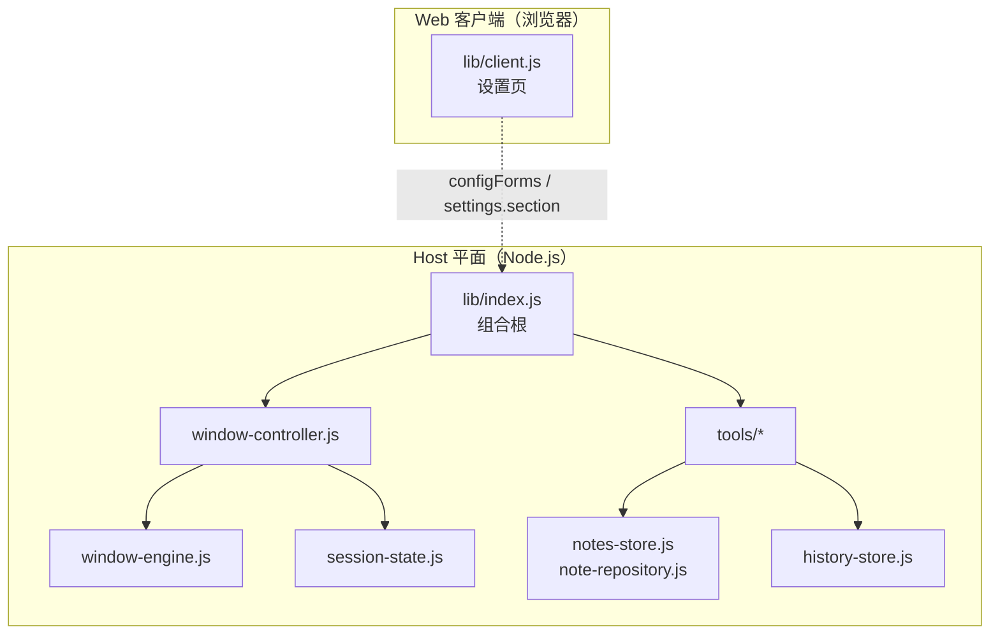
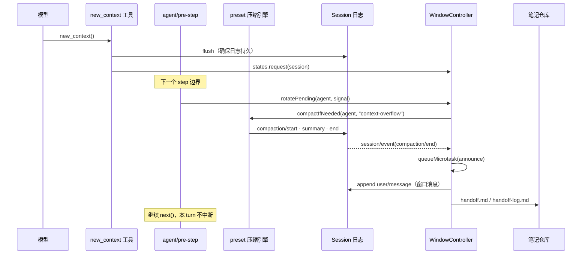

# 01 · 总体架构

## 目标

在 **DSH 原生压缩**之上提供“有长度上限的换窗交接”：

1. 压缩本身仍由会话所属 agent preset 的压缩引擎完成，插件不继承、不替换、不复制引擎；
2. 每次压缩提交后追加一条**窗口消息**，把摘要无法承载的会话状态（goal、todo、最近用户指令、笔记）带进下一个窗口；
3. 换窗后仍能通过 `history_*` 与 `notes_*` 找回精确信息；
4. 插件卸载、停用或宿主缺席时，压缩行为与 DSH 出厂一致。

一句话：**插件只负责“在压缩之后补一条消息、并维护窗口目录”，不负责压缩质量。**

## 两个平面

- **Host 平面**是插件的主体：注册工具、命令、系统提示段，监听 `agent/pre-step`、`session/event`、`settings/document-updated`。
- **Web 客户端**只有一个设置页，通过 DSH 的 `configForms` 读写同一份后端设置，不持有业务状态。

客户端模块由 `package.json` 的 `dsh.client` 声明（`platform: web`，注入 `dsh-client-ui-settings`、`dsh-client-locale`、`dsh-client-ui-renderer`），
入口是 `exports["./client"]`。它不参与换窗逻辑，删掉它只会失去设置页，`/ctx` 仍然可用。

## 组件与职责

| 组件 | 职责 | 不负责 |
| --- | --- | --- |
| `lib/index.js` | 配置读取、工具/命令/提示段注册、监听器、设置变更、`contextWindows` 服务 | 具体换窗算法 |
| `lib/window-policy.js` | 纯策略：`toolsEnabled()`、`strategyFor()` | 任何 I/O |
| `lib/window-controller.js` | 换窗编排、失败收尾、交接笔记排队 | 窗口消息的文本格式 |
| `lib/window-engine.js` | 构造窗口消息与 `<window_record>` | 何时换窗 |
| `lib/session-state.js` | 把不可变会话日志折叠成可变投影 | 持久化（日志本身由 DSH 负责） |
| `lib/note-repository.js` | 每会话笔记快照的持久化 | 笔记语义（由 `notes-store` 定义） |
| `lib/notes-store.js` | 路径解析、容量、切片、搜索 | 磁盘 |
| `lib/history-store.js` | 只读分页、搜索、按 ID 读取 | 写入历史 |
| `lib/tools/*` | 模型可见的五个工具 | 业务规则（调用上面的模块） |
| `lib/client.js` | 设置页 UI | 业务状态 |

## 关键时序

一次显式换窗（`new_context`）的完整路径：

要点：

- **请求与执行分离**。`new_context` 只登记“下一个安全边界换窗”，不立即压缩；当前 step 的工具结果必须先落盘。
- **执行走 preset 自己的引擎**。`agentPresets.serviceFor(agent, 'compaction')` 找不到时退回宿主 `compaction` 服务；两者都没有就明确报错。
- **窗口消息在 `compaction/end` 之后**。会话在发布事件时不能追加，所以用 `queueMicrotask`；当前 DSH 的 `compactSurfaceRegion` 在 append 后同步返回，微任务先于引擎续体执行，溢出重试能看到窗口消息。
- **失败可见但不致命**。没有引擎、策略是 native、没有可压缩区间、压缩报错，都会通过一条 `user/message` 告诉模型“这次没换成”，并清掉 pending。

## 六条设计原则

1. **压缩归 DSH，换窗归插件。**
   插件不碰 `thresholdRatio`、`retainRatio`、摘要器或 preset；升级 DSH 不需要同步 preset。
2. **只追加，不改写。**
   插件只追加窗口消息和笔记文件，从不修改 DSH 写下的摘要、历史或日志事件类型。
3. **会话隔离是硬边界。**
   状态存在以 `Session` 为键的 `WeakMap` 里；笔记路径固定为 `self/notes/...`；历史只读调用者自己的日志。
4. **有损但可恢复。**
   窗口消息有字符预算，摘要可能省略细节；`history_read` 保留原始事件，`notes_*` 保存跨窗口事实。
5. **注册全部走 Cordis 生命周期。**
   工具、命令、提示段、监听器、`contextWindows` 服务都通过 `ctx.effect` / `ctx.on` 注册，卸载即撤销，热重载不会重复。
6. **辅助状态失败不阻塞主循环。**
   笔记损坏、交接写失败、窗口消息追加失败都只记录警告；只有取消信号会向上传播。

## 明确不做的事

- 不替换、不继承、不复制 `BasicCompactionEngine`，也不改任何 preset。
- 不写未知的 session event 类型（当前 DSH 无法重新打开含未知事件的日志）。
- 不提供跨会话读取：没有 `agent_name` 选择器，历史与笔记都限定在调用者会话。
- 不把摘要正文再截断或改写；窗口消息只引用摘要，不复制正文。
- 不承诺无损恢复；交接是摘要 + 按需检索。

## 对外契约

| 契约 | 位置 | 消费方 |
| --- | --- | --- |
| `contextWindows` 服务 `{ states, getConfig() }` | `lib/index.js` | `dsh-autocompact` 等插件读取 pending 与策略 |
| 工具名 `new_context` / `notes_*` / `history_*` | `lib/tools/*` | 模型、preflight 冲突检查 |
| 命令 `/ctx` | `lib/index.js` | 用户 |
| 窗口消息格式 `<context_window>` + `<window_record>` v3 | `lib/window-engine.js` | `session-state.js` 折叠、旧日志兼容 |
| 笔记快照 `{ version: 1, session_id, files }` | `lib/note-repository.js` | 恢复、损坏隔离 |
| 设置文档 id `context-management` | `lib/index.js` | 设置页、`/ctx`、`settings.update` |

改这些契约时，必须同时改 `docs/design/` 对应文档、两份 README、`scripts/preflight.mjs` 与测试。
