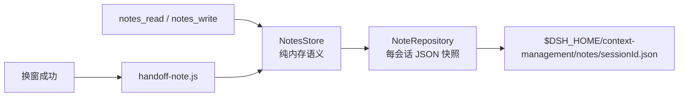

# 04 · 笔记（notes-store / note-repository / handoff-note）

笔记解决的是“摘要会丢细节，但有些事实必须跨窗口保留”的问题：进度、决定、待验证项、用户偏好。
它**不是**聊天历史的副本，也不承诺完整恢复。

## 两层结构

| 层 | 职责 | 不负责 |
| --- | --- | --- |
| `NotesStore` | 虚拟路径、容量校验、行切片、搜索、列表 | 磁盘、锁、原子性 |
| `NoteRepository` | 每会话快照的加载/保存、文件锁、原子替换、损坏隔离 | 笔记语义 |
| `handoff-note.js` | 换窗后写 `handoff.md` / `handoff-log.md` | 用户笔记的常规读写 |

这样拆的原因：`NotesStore` 可以脱离文件系统做纯逻辑测试；`NoteRepository` 只关心“怎样安全地把一份快照换上去”。

## 虚拟路径

- 相对路径 `progress.md` → `self/notes/progress.md`；
- 绝对路径 `<agent>/notes/<path>` 只在**读取/列表**时允许跨 agent 形式，但 `writeNote` 强制要求 `self/notes/` 前缀；
- 拒绝空段、`.`、`..`、超长路径（>512 UTF-8 字节）；
- 没有 `agent_name` 参数：调用者只能操作自己的会话。

**为什么保留 `<agent>/notes/` 形式？** 早期版本支持多 agent 命名空间；现在写入被收紧到 `self`，
读取仍兼容旧快照里的路径，避免升级后旧笔记读不出来。

## 容量与裁剪

| 限制 | 值 | 行为 |
| --- | --- | --- |
| 单文件 | 1,000,000 UTF-8 字节 | 超限报错，不截断 |
| 文件数 | 64（仓库）/ 256（默认 store） | 超限报错，不淘汰旧文件 |
| 总字节 | 4,000,000 | 超限报错 |
| 快照编码大小 | 25,000,000 字节 | 加载时拒绝并隔离 |

**绝不静默删除旧笔记**。容量不足时返回明确错误，让模型/用户决定删哪个文件。

## 持久化

`NoteRepository.write()`：

1. `mkdir` 笔记目录（0700）；
2. `withFileLock(file, ...)`：跨进程串行；
3. 在锁内**重新加载**快照，合并本次写入（避免两个进程互相覆盖）；
4. `signal.throwIfAborted()` 两次（写前、写后）；
5. `writeFileAtomic(file, json, { mode: 0o600, dirMode: 0o700 })`；
6. 返回 `{ store, result }`，由 `SessionStateStore.writeNote` 在成功后替换内存缓存。

**失败不换缓存**：磁盘写失败时，内存里仍是上一份已保存的快照；不会出现“界面显示已保存、磁盘没有”的状态。

## 损坏隔离

`load()` 只把 `ENOENT` 当作“空笔记”。其他情况（JSON 解析失败、版本/路径/时间戳非法、编码过大）：

1. 把原文件重命名为 `<sessionId>.json.corrupt-<ISO 时间>`（**保留，不删除**）；
2. 通过构造时注入的 `warn` 回调记录一行警告；
3. 返回空 `NotesStore`。

这样做的理由：笔记是辅助状态，一个坏文件不应让会话的每个 step 都失败。
隔离而不是删除，是为了让用户还能手工恢复。`agent/pre-step` 另外包了 try/catch，即使状态层再抛错也只记警告、不拒绝 step。

## 换窗交接笔记

| 文件 | 写入方式 | 内容 |
| --- | --- | --- |
| `self/notes/handoff.md` | 每次换窗**替换** | 标题 + 时间/来源/item + 摘要正文（≤200,000 字符） |
| `self/notes/handoff-log.md` | 每次换窗**追加**一行 | `- win_N 时间 item_<seq> 来源: 首行` |

- 两者都在 `HANDOFF_PATHS` 里，窗口消息生成时会排除，避免把交接笔记再塞回交接。
- `recordHandoff` 用 `outgoing.summary_item_id` 找摘要事件；没有摘要 item 时返回 false（不写）。
- 幂等：`handoff-log.md` 已含 `- <window_id> ` 开头的一行就跳过。
- 写入按会话排队；`handoffWrites` 只是完成回执，不是其他会话的依赖。

## 工具映射

| 工具 | 行为 |
| --- | --- |
| `notes_read({ path })` | 按路径读取，支持行范围与字符分页 |
| `notes_read({ query })` | 字面量、大小写敏感搜索；每个文件最多 5 条匹配，最多 10 个文件 |
| `notes_read({})` | 列出文件（按 `updated_at` 降序，最多 20） |
| `notes_write({ path, text, mode })` | `mode` 必填：`replace` 覆盖 / `append` 追加 |

读写分离是刻意的：旧版把“追加”藏在默认行为里，容易误覆盖；现在必须显式声明。

## 失败模式

| 情况 | 结果 |
| --- | --- |
| 没有持久化后端（`flush` 返回 false） | `notes_write` / `new_context` 报错，不假装成功 |
| 磁盘满 / 原子写失败 | 工具返回错误，内存缓存保持旧值 |
| 快照损坏 | 隔离 + 空笔记 + 警告；会话继续 |
| 并发写同一文件 | 文件锁串行，后写者基于前写者的内容合并 |
| 取消信号 | 写前/写后检查；取消不更新缓存 |

## 修改时注意

- 改快照格式 → 升 `version`，在 `load()` 里保留旧版本读取分支，并加恢复测试。
- 改容量限制 → 同步 README 的 Limits 表、`NotesStore` 默认值、`NoteRepository.LIMITS`。
- 不要用 `fs.writeFileSync` 直接覆盖快照：会破坏原子性与锁语义。
- 不要把笔记内容注入系统提示；它只通过 `notes_read` 和窗口消息的节选进入模型。
