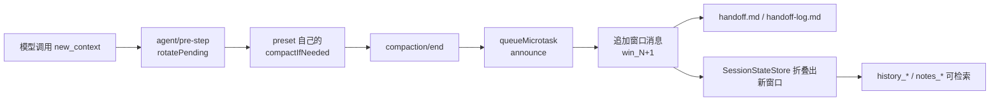

# 设计文档索引

本目录说明 `dsh-multi-window-context-management` 每个模块与功能的设计思想，面向后续维护者。
它回答“为什么这样拆、边界在哪里、改哪里会牵动什么”，而不是重复 README 的使用说明。

> `docs/handoffs/` 是本地私有的工作交接记录（已在 `.gitignore` 中忽略），不属于公开文档；
> 本目录 `docs/design/` 才是随仓库维护的设计文档。

## 建议阅读顺序

| 顺序 | 文档 | 先读它的理由 |
| --- | --- | --- |
| 1 | [01-architecture.md](./01-architecture.md) | 两个平面（Host 插件 / Web 客户端）、数据流和六条设计原则 |
| 2 | [02-session-state.md](./02-session-state.md) | 所有功能共享的会话投影：窗口、goal/todo、pending 请求 |
| 3 | [03-window-rotation.md](./03-window-rotation.md) | 核心功能：换窗请求、原生压缩、窗口消息、交接笔记 |
| 4 | [04-notes.md](./04-notes.md) | 笔记模型、容量限制、原子持久化与损坏隔离 |
| 5 | [05-history.md](./05-history.md) | 只读历史检索、`item_<seq>` 地址、分页上限 |
| 6 | [06-tools.md](./06-tools.md) | 五个工具、lazy 门控、注册生命周期 |
| 7 | [07-settings-client-i18n.md](./07-settings-client-i18n.md) | 配置 schema、设置页、`/ctx`、语言跟随 |
| 8 | [08-preflight-tests.md](./08-preflight-tests.md) | 能力预检与测试策略：怎样证明“还能用” |
| 9 | [09-maintenance.md](./09-maintenance.md) | 常见改动清单、DSH 升级与发布检查表、已知坑 |

## 模块地图

```text
lib/
  index.js            组合根：配置、注册、监听、命令、系统提示段
  window-policy.js    纯策略：enabled/injectTools、window vs native
  window-controller.js 换窗编排：请求 → 预检 → 原生压缩 → 窗口消息 → 交接笔记
  window-engine.js    窗口消息构造：预算、记录格式、快照节选
  session-state.js    会话日志的增量投影（WeakMap，每会话一份）
  handoff-note.js     handoff.md / handoff-log.md 的写入
  notes-store.js      纯内存笔记模型（路径、容量、切片、搜索）
  note-repository.js  每会话 JSON 快照：文件锁 + 原子写 + 损坏隔离
  history-store.js    会话日志的只读分页视图
  text.js             文本提取、裁剪、分页等纯函数
  locale.js           en/zh 文案与宿主语言解析
  client.js           Web 设置页（lazy-CJS 客户端模块）
  tools/              new_context、notes_*、history_* 的工具定义与处理器
scripts/
  preflight.mjs       按能力检查目标 DSH 与 profile
  dsh-env.mjs         定位 DSH、profile、$DSH_HOME
test/                 node:test + 真实 Cordis/Session/CompactionEngine
```

## 一条主线



所有模块都围绕这条主线：`session-state` 提供“现在在哪个窗口”，`window-controller/engine` 负责推进，
`notes` 与 `history` 负责在换窗后仍能找回精确信息，`index` 负责把这些能力挂到 DSH 的生命周期上。

## 维护约定

- 本目录文档随公开行为一起改；行为变了而文档没变，视为未完成。
- 代码注释用英文，设计文档用中文（面向本项目的维护者）。
- 文档里引用源码时写相对路径与行号，例如 `lib/window-controller.js:80`；行号漂移时以函数名为准。
